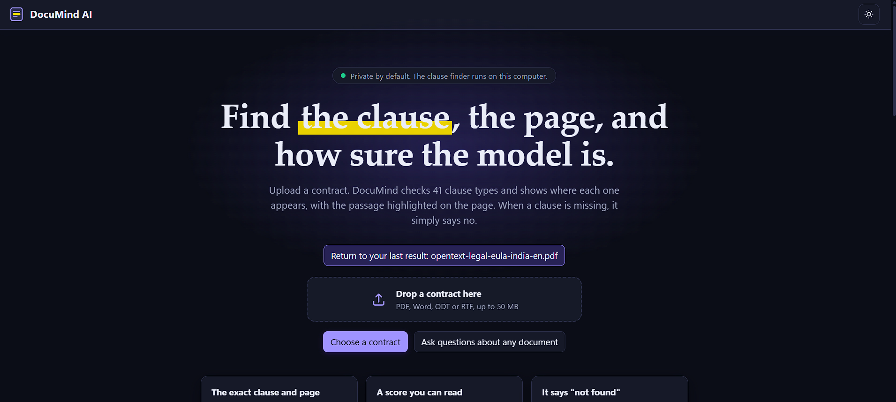
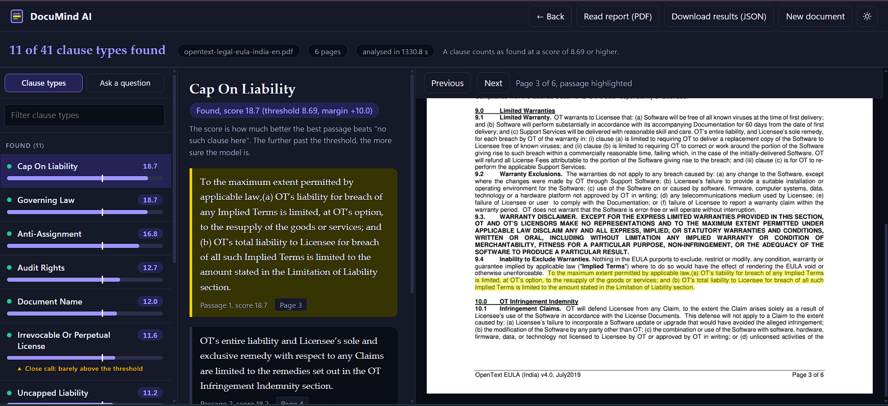
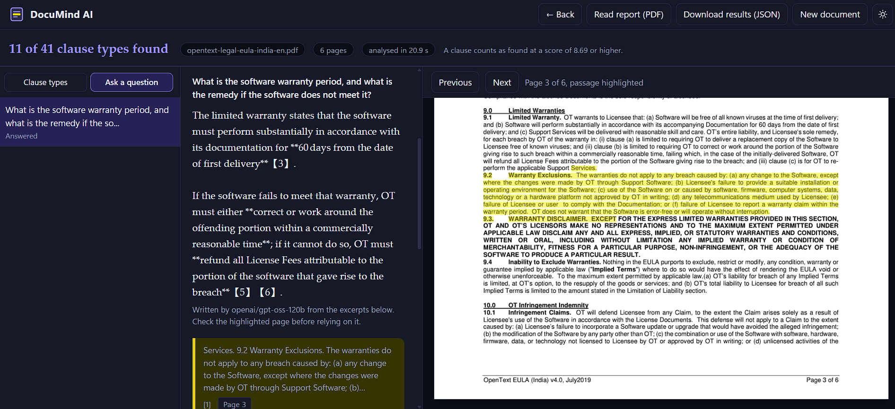
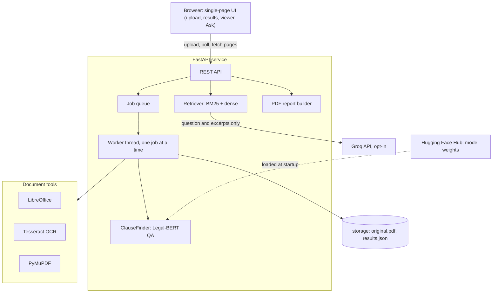
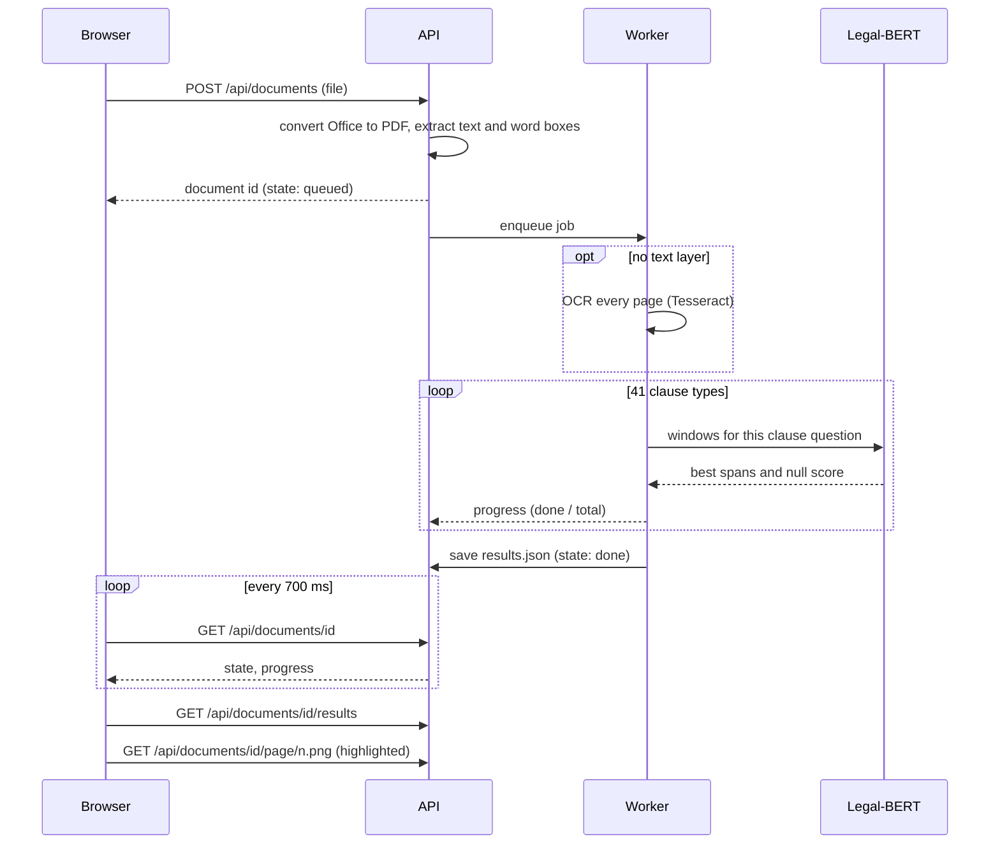
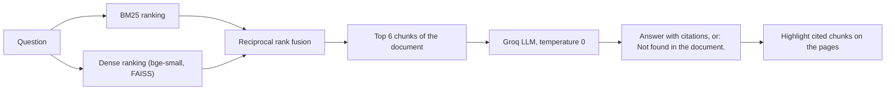
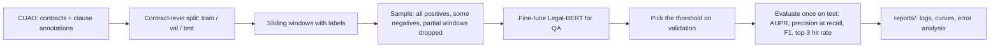
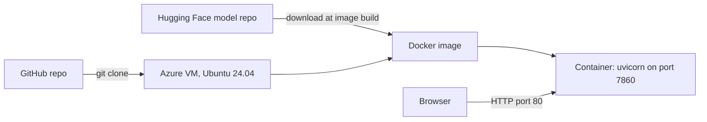

# DocuMind AI

**Contract clause finder that shows the exact passage on the exact page, and says "not found" instead of guessing.**


DocuMind AI reads a contract (PDF, Word, ODT, RTF or a scan) and checks it for the 41 clause types of the [CUAD](https://www.atticusprojectai.org/cuad) benchmark: governing law, termination, liability caps, audit rights, and so on. For every clause it finds, it returns the evidence passages, their page numbers and a confidence score, and highlights each passage on the original page so a reviewer can verify it in seconds.

The core is a Legal-BERT model fine-tuned for extractive question answering **with abstention**. An abstention threshold, chosen on a validation set and never on the test set, decides when the system stays silent. The project covers the full path: data preparation, training, evaluation against retrieval baselines, a production-style API, a web interface, OCR and Office support, an optional LLM question mode, tests, and containerised deployment.

## Contents

1. [Links](#links)
2. [Features](#features)
3. [Screenshots](#screenshots)
4. [Results](#results)
5. [Architecture](#architecture)
6. [Design decisions and trade-offs](#design-decisions-and-trade-offs)
7. [Tech stack](#tech-stack)
8. [Quick start](#quick-start-local)
9. [Configuration](#configuration)
10. [Docker and deployment](#docker-and-deployment)
11. [API](#api)
12. [Reproducing the training and evaluation](#reproducing-the-training-and-evaluation)
13. [Testing](#testing)
14. [Project layout](#project-layout)
15. [Security and privacy](#security-and-privacy)
16. [Limitations](#limitations)
17. [Possible next steps](#possible-next-steps)
18. [Acknowledgements](#acknowledgements)

## Links

- Code: https://github.com/rock917/Documind_AI
- Model (Legal-BERT fine-tuned on CUAD-QA): https://huggingface.co/TheRock45/documind-legalbert-qa
- Live demo: http://20.207.196.84 (Azure VM, CPU only). It is switched on only for demos, so the link may not respond. If it times out, ask the author to start it. Analysing an uploaded contract is slow there (about 22 minutes for a 6-page one). It uses plain HTTP with no login, and Ask mode is off on the demo server.

## Features

- **Clause finder.** For each of the 41 CUAD clause types, the model returns the best passages (top 3), their pages and a score. Clauses below the threshold are reported as **Not found**. Clauses only just above it are flagged as a **close call**.
- **Highlighted evidence.** The page image is rendered on the server with the matching words highlighted. Click a passage to jump to its page.
- **Principled abstention.** The decision rule is tuned on validation data and never on test data (see [Results](#results)).
- **Ask mode.** Ask your own question about any document. BM25 and dense retrieval are fused with reciprocal rank fusion, then a Groq-hosted model answers with page citations, or says `Not found in the document.` It is opt-in per question.
- **Any document type.** PDF, Word (`.docx`, `.doc`), ODT and RTF (converted with LibreOffice), and scanned PDFs (OCR with Tesseract, up to 100 pages).
- **Reports.** A readable PDF report of everything found, and a JSON export of the raw results.
- **Interface.** A single-page web UI with a light/dark theme, history-based Back/Forward navigation and a live progress bar.

## Screenshots

### Landing page

Upload a contract, or skip the clause checks and ask your own questions.



### Results

Clause types found are listed on the left with their scores. The middle panel shows the evidence passages, and the right panel shows the original page with the passage highlighted.



### Ask mode

Ask a question about any document. The answer cites the pages it came from, or says it was not found.



## Results

The task is built from CUAD-QA, regrouped per (contract, clause type) so that "this clause is absent" is a first-class answer, as in SQuAD v2. The 41-way question set is run over each contract, and the threshold is applied to the *present score*: the best answer span's score minus the "no answer" score.

Test-set results (threshold 8.690, chosen on the validation split of 51 contracts):

| Metric | Legal-BERT | bert-base |
|---|---|---|
| AUPR (present vs. absent) | **0.939** | 0.918 |
| Precision at 80% recall | **0.918** | 0.887 |
| F1 | **0.894** | 0.882 |
| Absent clauses correctly skipped | **96.7%** | 96.5% |
| Present clauses found | **80.9%** | 76.8% |
| Right passage in the top 3 (flagged clauses) | 96.4% | **96.8%** |

- Per-clause numbers, risk-coverage curves and error analysis are in [`reports/`](reports/).
- bert-base AUPR confidence interval: 0.904 to 0.930.
- Legal-BERT is ahead on every headline metric except top-3 passage hit rate. No paired significance test was run between the two models, so treat the gap as indicative.
- About 19% of present clauses are missed, which is the price of a cautious threshold.

## Architecture

### System overview



### Request lifecycle



### Document processing

The model reads **one plain string**: every word of the document joined by single spaces. For each word the system records its character range in that string, its page and its box on the page. A predicted span `(char_start, char_end)` is therefore converted to page numbers and highlight rectangles by an exact lookup, with no fuzzy text matching. This is what makes the highlights reliable.

Files go through a small preparation stage first:

- Word, ODT and RTF files are converted to PDF with headless LibreOffice.
- A PDF with no extractable text is treated as a scan. Each page is rendered at 200 DPI and OCR-ed with Tesseract (English), producing a PDF with an invisible text layer, so the rest of the pipeline is identical. OCR is capped at 100 pages, with a per-page time limit.

### Clause detection

1. **Windowing.** For each clause type there is one fixed question. The question and the contract are tokenised together and cut into overlapping windows of 384 tokens with a stride of 128.
2. **Scoring.** The model gives every window start and end logits. The "no answer" score of a window is the start logit plus the end logit at the CLS token.
3. **Decoding.** Per window, the best non-overlapping spans are kept. Per contract and clause, the best span over all windows is chosen, and
   `present score = best span score - minimum null score over the windows` (the SQuAD v2 convention).
4. **Decision.** If the present score reaches the threshold (8.690, from validation), the clause is **found** and the top 3 non-overlapping passages are returned with pages and highlight boxes. Otherwise the answer is **not found**. The margin above the threshold is stored, and a margin under 3 is shown as a close call.

On a GPU the model runs in half precision.

### Ask mode



- The document is cut into 120-word chunks with a stride of 60, once per document.
- Only the question and the few retrieved excerpts are sent to Groq, never the whole file, and only when the user ticks consent for that question.
- The system prompt forces the model to answer only from the numbered excerpts and to reply with an exact sentence when the answer is not there.

### Training and evaluation pipeline



- **Contract-level splits.** No contract appears in more than one split, so there is no leakage between training and test.
- **Window labels.** A window is *positive* if an answer lies fully inside it, *negative* if no answer overlaps it (the target is the CLS token), and *partial* if an answer is cut by the window edge. Partial windows are excluded from training, because calling them "no answer" would teach the model to ignore real clause text.
- **Sampling.** Every positive window is kept, and only a random fraction of negatives, with separate rates for negatives from contracts that contain the clause elsewhere and from contracts that do not. Test windows are never sampled.
- **Selection.** The abstention threshold is chosen on the validation split only.

### Deployment



## Design decisions and trade-offs

| Decision | Why | Trade-off |
|---|---|---|
| Extractive QA with a null answer, not a classifier | The same model finds the passage and decides presence, so every "found" comes with its evidence | Needs windowing and span decoding, and is slower than a classifier |
| Threshold chosen on validation, applied once to test | Test numbers stay honest | The threshold is tuned to one data distribution |
| One plain-text string plus a word table | Exact page and highlight mapping | A modest amount of bookkeeping per document |
| Highlights rendered on the server | The browser needs no PDF library, and the highlight is the same everywhere | Each page view is an image request |
| One worker thread and an in-memory job list | Simple, and one model instance is enough for one demo user | No parallel documents and no persistence across restarts |
| Ask mode is opt-in per question | The user decides what leaves their machine | An extra click |
| Model weights on Hugging Face, not in Git | A 436 MB file does not belong in a repo | The first Docker build needs internet access |
| Legal-BERT as the main model | Domain pre-training on legal text | A bert-base baseline is kept for comparison, and it is close |

## Tech stack

| Area | Tools |
|---|---|
| Modelling | PyTorch, Hugging Face Transformers, Legal-BERT (`nlpaueb/legal-bert-base-uncased`), scikit-learn |
| Retrieval | BM25 (own implementation), `BAAI/bge-small-en-v1.5` with sentence-transformers, FAISS |
| Backend | FastAPI, Uvicorn, Pydantic, a worker thread with a queue |
| Documents | PyMuPDF, Tesseract OCR, LibreOffice (headless) |
| Frontend | One HTML file with vanilla JavaScript and CSS variables |
| LLM (optional) | Groq's OpenAI-compatible API, `openai/gpt-oss-120b` |
| Quality | pytest (144 tests) |
| Delivery | Docker, Hugging Face Hub, Azure virtual machine |

## Quick start (local)

Tested with Python 3.13 on Windows. Tesseract and LibreOffice are optional: without them, scans and Word files fail with a clear error message.

```
git clone https://github.com/rock917/Documind_AI.git
cd Documind_AI
python -m venv .venv
.venv\Scripts\activate
pip install torch
pip install -r requirements.txt
hf download TheRock45/documind-legalbert-qa --local-dir checkpoints/legalbert_qa/final
python -m uvicorn documind.api.main:app --host 127.0.0.1 --port 8000
```

On Linux or macOS, activate with `source .venv/bin/activate`. Open http://127.0.0.1:8000 and upload a contract. A GPU is used automatically if PyTorch can see one.

**Ask mode** needs a free [Groq](https://console.groq.com) API key. Create a file named `.env` next to this README containing one line, `GROQ_API_KEY=your_key`. It is git-ignored. Without a key the rest of the app works normally.

Try the finder from the command line without the web app:

```
python -m documind.pipeline.analyze path\to\contract.pdf --categories "Governing Law,Parties"
```

## Configuration

**`configs/inference.json`**

| Key | Meaning |
|---|---|
| `model_dir` | Local folder or Hugging Face repo id of the fine-tuned model |
| `tokenizer` | Tokenizer name or path |
| `questions_path` | JSON file with the 41 clause questions |
| `threshold` | Abstention threshold on the present score (8.690, from validation) |
| `top_k` | Passages returned per clause (3) |
| `max_length`, `stride` | Window size and overlap in tokens (384, 128) |
| `batch_size` | Windows per forward pass |

**`configs/general.json`** (Ask mode): the Groq model and base URL, the embedding model, `top_k` (6), chunk size and stride (120 and 60 words), the request timeout and the maximum question length (500 characters).

**Environment variables**

| Variable | Purpose |
|---|---|
| `GROQ_API_KEY` | Enables Ask mode. Read from the environment or from a git-ignored `.env` file. An existing environment variable is never overridden by `.env`. |
| `DOCUMIND_SOFFICE` | Path to `soffice`, if LibreOffice is not on the PATH |
| `DOCUMIND_TESSERACT` | Path to `tesseract`, if it is not on the PATH |

## Docker and deployment

The Dockerfile installs Tesseract and LibreOffice, CPU-only PyTorch and the Python packages, and downloads the model from Hugging Face at build time.

```
docker build -t documind .
docker run -p 80:7860 documind
```

Open http://localhost. For Ask mode, add `-e GROQ_API_KEY=your_key`. Never commit a key.

The reference deployment is a 2-vCPU, 4 GB Azure VM with the container above. Analysis runs on CPU there, so it is slower than on a local GPU. Since the service has no login, the VM is only started for demos.

## API

| Method and path | Purpose |
|---|---|
| `POST /api/documents` | Upload a file (max 50 MB); returns a document id |
| `GET /api/documents/{id}` | State, progress, page sizes, OCR flag |
| `GET /api/documents/{id}/results` | Clause results with passages, pages and scores |
| `GET /api/documents/{id}/page/{n}.png` | A page image; `?hl=` highlights a character range |
| `GET /api/documents/{id}/report.pdf` | The readable PDF report |
| `POST /api/documents/{id}/ask` | Ask mode question with citations |
| `GET /api/general` | Whether Ask mode is available, and which model |
| `GET /api/about` | The 41 clause types and the threshold |

Interactive API docs are served by FastAPI at `/docs`.

## Reproducing the training and evaluation

The CUAD data is not included in this repository. Download it from the [Atticus Project](https://www.atticusprojectai.org/cuad) and see `configs/config.yaml` for the expected paths. Each step is a module with `--help`:

```
python -m documind.data.build_windows --split train
python -m documind.data.build_windows --split val
python -m documind.models.train_qa --name legalbert_qa --save
```

Evaluation modules live in `documind/eval/` (metrics, risk-coverage, hit-at-k, error analysis), and retrieval baselines in `documind/retrieval/`. Their outputs are the files in `reports/`. The training defaults are 2 epochs, learning rate 3e-5, batch size 8 with 4 gradient-accumulation steps. The exact run settings are recorded in `reports/train_legalbert_qa.json`.

## Testing

```
python -m pytest -q
```

144 tests cover windowing, span decoding, metrics, retrieval, PDF handling, the API, the report and Ask mode. The Ask mode tests inject a fake chat function, so no network or key is needed. The whole suite takes about a minute on the author's machine. On Windows, `--basetemp=.pytest_tmp` keeps pytest's temporary files on the project drive.

## Project layout

```
documind/
  api/        FastAPI app, job manager, startup (loads .env)
  data/       CUAD-QA windowing (build_windows, window_stats)
  models/     QA fine-tuning (train_qa)
  eval/       Span decoding, metrics, risk-coverage, error analysis
  retrieval/  BM25, chunking, retrieval evaluation
  pipeline/   ClauseFinder: windows, model, threshold, evidence
  pdf/        Text and word boxes, OCR, Office conversion
  general/    Ask mode: hybrid retrieval and Groq client
  web/        index.html (the whole UI)
  report.py   PDF report builder
configs/      Inference and Ask mode settings
data/         Clause questions (the CUAD data itself is not included)
reports/      Training logs, evaluation results, curves
scripts/      Small utilities (OCR quality check, model list)
tests/        144 automated tests
Dockerfile    CPU image for deployment
```

## Security and privacy

- **No login.** The service is meant for a single user or a short demo. Anyone who can reach a running instance can upload files and use it, so do not expose it permanently without adding authentication.
- **Uploads** are stored under `storage/<random id>/` on the server and are not shared between documents. The folder is git-ignored.
- **Ask mode** sends only the question and a few excerpts to Groq, and only after the user ticks consent for that question. The API key stays on the server and is never logged or sent to the browser.
- **Secrets** live in the environment or a git-ignored `.env` file, never in the repository.
- **Upload limit** of 50 MB per file.

## Limitations

- **Scores are not probabilities.** They are raw model scores, calibrated only through the threshold. A higher score means more confident, but it is not a percentage.
- **Misses happen.** About 19% of present clauses are missed. A long, unusual or poorly scanned contract can score lower than the benchmark. Always read the evidence.
- **English commercial contracts only.** Other languages and non-contract documents mostly return "not found". Handwriting is not supported.
- **Ask mode highlights the whole retrieved chunk**, not the exact answer span, and depends on Groq's free-tier limits.
- **One document at a time**, with an in-memory job list that resets when the server restarts.
- **CPU is slow.** On a local GPU a contract is analysed in seconds. On the 2-vCPU Azure demo server, a 6-page contract took about 22 minutes (1,331 s), so the demo shows the interface and results rather than speed.
- **Licensing.** PyMuPDF is AGPL-licensed, so a closed-source deployment would need a commercial licence or a different PDF library. CUAD is released under CC BY 4.0.

## Possible next steps

- A paired significance test between the two models.
- Score calibration, so that a score can be read as a probability.
- Faster CPU inference, for example with a quantised model, followed by re-checking the threshold.
- Authentication and per-user storage for a permanent public deployment.
- Persistent job history.

## Try a sample contract

The front page has a **Try a sample contract** button. It opens a real contract from the CUAD test split (a supply agreement the model never saw in training) that was analysed in advance, so the viewer opens instantly, even on the slow CPU demo server. Open a clause, then check the highlighted passage on the page.

To make your own sample, build a PDF from a test contract and analyse it once (this uses your GPU if you have one):

```
python -m scripts.make_sample_pdf --list
python -m scripts.make_sample_pdf --index 0
python -m scripts.make_sample samples_src\cuad-sample.pdf --name cuad-sample
```

Every folder under `samples/` (an `original.pdf` and a `results.json`) is offered as a sample. The contract text comes from [CUAD](https://www.atticusprojectai.org/cuad), released under CC BY 4.0 by The Atticus Project.

## Acknowledgements

- [CUAD](https://www.atticusprojectai.org/cuad), the Contract Understanding Atticus Dataset by The Atticus Project
- [Legal-BERT](https://huggingface.co/nlpaueb/legal-bert-base-uncased) by Chalkidis et al.
- [Hugging Face Transformers](https://github.com/huggingface/transformers), [FAISS](https://github.com/facebookresearch/faiss), [FastAPI](https://fastapi.tiangolo.com/), [PyMuPDF](https://pymupdf.readthedocs.io/), [Tesseract](https://github.com/tesseract-ocr/tesseract) and [LibreOffice](https://www.libreoffice.org/)

Built by Bobby as a portfolio project.